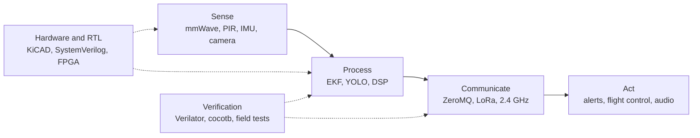

  
  
  
  

---

## About

I'm a B.Tech Electronics and Communication student at **NIT Goa**, and I build embedded and edge systems that have to be fast, reliable and measurable. My work runs from PCB design and RTL to real-time C++ and on-device vision, with a habit of validating every model against hardware.

Most recently I interned at QuickPay, where I built a YOLO and DeepStream pipeline on a Jetson Orin Nano running at 30+ FPS and stress-tested autonomous drone platforms. I like problems where the numbers decide whether the design is good.

---

## How I think about systems

Every stage gets a hardware layer underneath it and a verification layer on top of it. If I can't measure it, I don't trust it.

---

## Tech stack

**Languages**

**Hardware and platforms**

-24292F?style=flat-square)

**Firmware and systems**

**AI, DSP and verification**

**Tools**

---

## Selected work

<table>
  <tr>
    <td width="50%" valign="top">
      <h3><a href="https://github.com/kartikeyy12/EdgeFusion">EdgeFusion</a></h3>
      C++20 &nbsp;|&nbsp; ZeroMQ &nbsp;|&nbsp; OpenCV &nbsp;|&nbsp; Eigen3
      
A real-time sensor fusion pipeline that replaces ROS2 image transport with a custom C++20 stack. A 15-state EKF fuses 200 Hz IMU and 30 Hz camera data over zero-copy ZeroMQ IPC, reaching 277 us latency (25 to 80x faster) and saving 27 MB/s of bandwidth.

    </td>
    <td width="50%" valign="top">
      <h3><a href="https://github.com/kartikeyy12/Fault-Tolerant-RISC-V-SoC">Fault-Tolerant RISC-V SoC</a></h3>
      SystemVerilog &nbsp;|&nbsp; Yosys &nbsp;|&nbsp; Verilator &nbsp;|&nbsp; cocotb
      
A temporal lockstep dual-core RV32I SoC that compares PC, ALU and register writeback every cycle, paired with a 4x4 systolic array accelerator. Verified with UVM-style tests and synthesized for a Gowin GW1NR-9 FPGA with zero structural errors across 26,897 cells.

    </td>
  </tr>
  <tr>
    <td width="50%" valign="top">
      <h3><a href="https://github.com/kartikeyy12/LoRa-Perimeter-Detection">LoRa Perimeter Detection System</a></h3>
      ESP32 &nbsp;|&nbsp; LoRa &nbsp;|&nbsp; 24 GHz mmWave &nbsp;|&nbsp; PIR
      
A low-power sensor node that fuses mmWave radar with PIR to classify movement as human, animal or vehicle, then sends alerts over long-range LoRa. In progress, currently focused on data collection and classification reliability.

    </td>
    <td width="50%" valign="top">
      <h3><a href="https://github.com/kartikeyy12/GFSK-Digital-Walkie-Talkie">GFSK Digital Walkie-Talkie</a></h3>
      Arduino &nbsp;|&nbsp; NRF24L01 &nbsp;|&nbsp; MATLAB &nbsp;|&nbsp; KiCAD
      
A custom 2.4 GHz half-duplex transceiver on a KiCAD-routed PCB. MATLAB link-budget models were validated in hardware, reaching 1.5 to 2 km of clear audio with 8-bit PCM quantization and a custom PWM-based DAC filter.

    </td>
  </tr>
</table>

---

## GitHub activity

 

---

## Beyond the terminal

I coordinate outreach for the **SPIE Student Chapter at NIT Goa**, running hands-on STEM workshops and school science exhibitions across Goa. I'm also Vice-President of **Exposure Explorers**, the photography club, where I lead the visual documentation of campus events.

---

Always happy to talk about embedded systems, edge AI or anything with a tight latency budget.

<a href="mailto:kartikey120207@gmail.com">kartikey120207@gmail.com</a>

