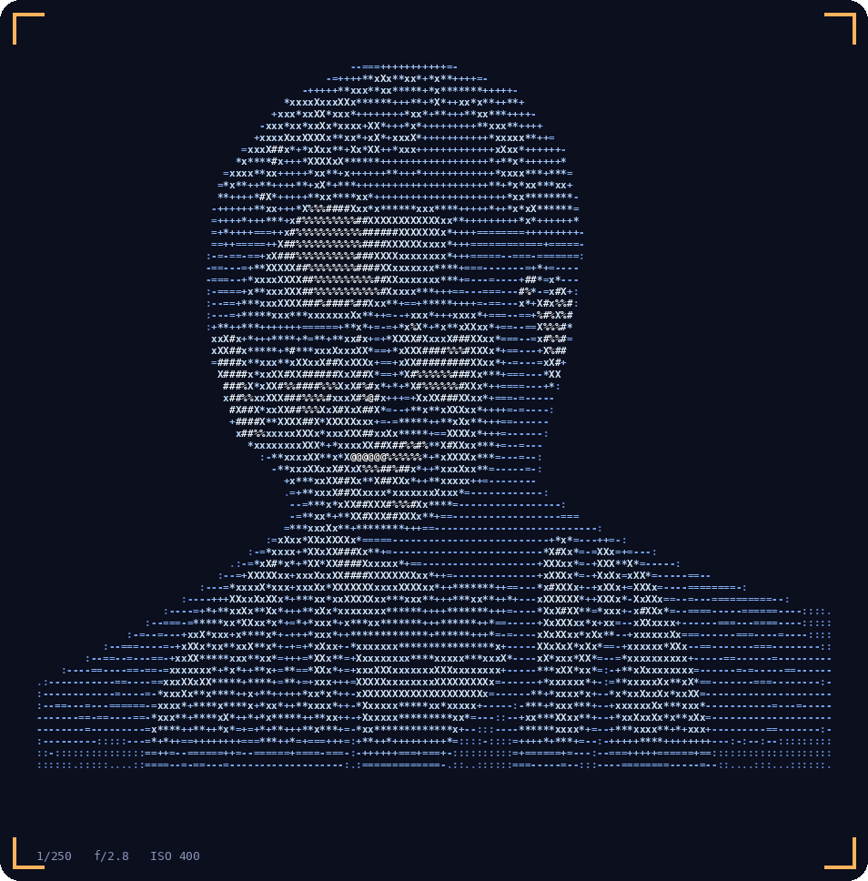
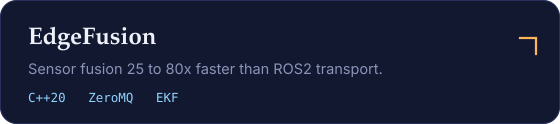
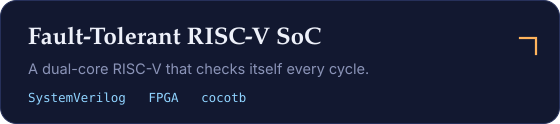
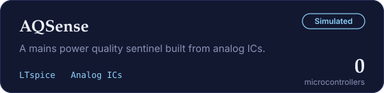
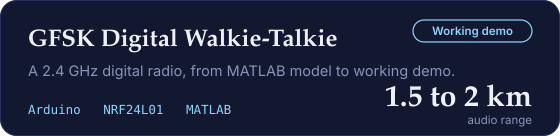
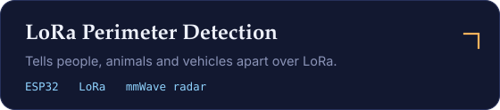
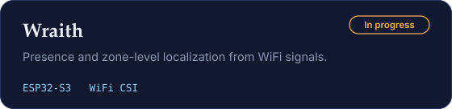

  

 

<table>
  <tr>
    <td width="42%" valign="middle" align="center">
      
    </td>
    <td width="58%" valign="middle">
      <h3>Hey, I'm Kartikey.</h3>
      
I'm a student at NIT Goa who likes building things with real potential to solve a problem, usually one that was personally bugging me. Other times I build purely because it's fun.

      
That mostly means radios, sensors, FPGAs and the fast software that talks to them. I work in C++, Python, SystemVerilog and MATLAB, on ESP32, Jetson and whatever silicon the problem needs.

      
Most recently I was a trainee engineer at QuickPay, where I built a YOLO and DeepStream vision pipeline on a Jetson Orin Nano running at 30+ FPS.

      
When I'm not building, I'm behind a camera. I'm Vice-President of the photography club at NIT Goa and I help run the SPIE student chapter.

      
<b>Open to internships in embedded systems, edge AI and FPGA/RF.</b> If you have a hard problem sitting next to a sensor or a radio, <a href="mailto:kartikey120207@gmail.com">say hi</a>.

    </td>
  </tr>
</table>

 

### Things I've built

<table>
  <tr>
    <td width="50%"></td>
    <td width="50%"></td>
  </tr>
  <tr>
    <td width="50%"></td>
    <td width="50%"></td>
  </tr>
  <tr>
    <td width="50%"></td>
    <td width="50%"></td>
  </tr>
</table>

 

[Portfolio](https://kartikeybuilds.vercel.app/) &nbsp;&nbsp;&nbsp; [LinkedIn](https://www.linkedin.com/in/kartikey-tiwari-319047342/) &nbsp;&nbsp;&nbsp; [Hackster.io](https://www.hackster.io/kartikey-tiwari) &nbsp;&nbsp;&nbsp; [Email](mailto:kartikey120207@gmail.com)

